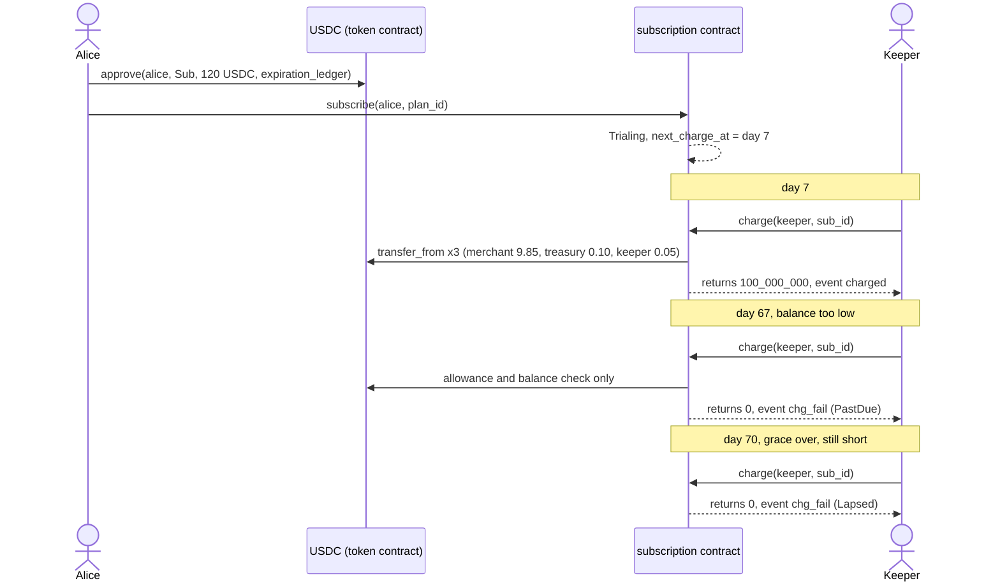

# LumenSub contracts

[](https://github.com/lumensub/lumensub-contracts/actions/workflows/ci.yml)

Two Soroban contracts that let a business bill customers on a schedule, in USDC or any
other Stellar asset, without ever holding their money. The subscriber approves a
spending limit once. After that, each period's payment is pulled when it falls due, by
whoever calls `charge` first, and the rules for how much and how often sit in the
contract where both sides can read them.

This repo is the part that moves money. [lumensub-backend](https://github.com/lumensub/lumensub-backend)
indexes it and runs a keeper, and [lumensub-app](https://github.com/lumensub/lumensub-app)
is the dashboard, checkout and subscriber portal. Neither is needed for billing to work,
which is most of the point.

## One subscription, from the chain's side

Alice subscribes to a 10 USDC monthly plan with a 7-day free trial and a 3-day grace
period. In contract terms:

```
amount       100_000_000   (10 USDC; Stellar assets use 7 decimals)
period_secs    2_592_000   (30 days)
trial_secs       604_800   (7 days)
grace_secs       259_200   (3 days)
max_cycles             0   (renew until cancelled)
```

The protocol fee and keeper reward are the deploy defaults: `fee_bps = 100` (1%) and
`keeper_reward_bps = 50` (0.5%). Status numbers are what the contract stores.

| Day | Call | Tokens moved | Status after | `next_charge_at` |
|---|---|---|---|---|
| 0 | `subscribe(alice, plan)` | nothing; a trial signup doesn't even check the allowance | `Trialing` (0) | day 7 |
| 7 | `charge(keeper, sub)` | 9.85 to the merchant's payout, 0.10 to the treasury, 0.05 to the keeper | `Active` (1), cycle 1 | day 37 |
| 37 | `charge(keeper, sub)` | same split again | `Active` (1), cycle 2 | day 67 |
| 67 | `charge(keeper, sub)`, Alice holds 4 USDC | nothing; `charge` returns 0 and publishes `chg_fail { reason: balance, status: 2 }` | `PastDue` (2) | still day 67 |
| 68 | another keeper retries | nothing | `PastDue` (2) | still day 67 |
| 70+ | the first retry at or after day 67 + 3 | nothing | `Lapsed` (5), final | |

If Alice tops up on day 69 instead, the next retry succeeds: cycle 3, the usual split,
status back to `Active`, and the schedule restarts from the moment she paid, so the
next charge is due on day 99. She is never billed twice for the gap.

Three details people miss. Lapsing is not a timer: a subscription only lapses when
someone attempts a charge after the grace period, so a past-due subscription nobody
touches stays past due. A plan without a trial charges the first period inside
`subscribe` itself, with the treasury fee but no keeper reward (there is no keeper),
so the merchant gets 9.90 that time. And calling `charge` on day 36 fails with
`NotDue` and costs the caller their transaction fee, nothing else.



The numbers above come straight from `split_payment` in
[`pricing.rs`](contracts/subscription/src/pricing.rs) (its first unit test checks the same
1% and 0.5% split on a 1 USDC charge), and from the tests in
[`test/billing.rs`](contracts/subscription/src/test/billing.rs) and
[`test/failed_charges.rs`](contracts/subscription/src/test/failed_charges.rs).

## Design decisions

**Pull payments through token allowances.** Stellar payments are pushed by the payer,
which is fine for invoices and useless for a monthly membership. A Soroban allowance
lets the subscriber hand the contract a ceiling instead of a signature per payment. The
ceiling lives on the token, not in our contract, so a subscriber can lower or remove it
from any wallet without asking us. The cost is real: allowances expire (the app asks for
up to about 3.1 million ledgers, roughly six months), and subscribers have to approve
again before then.

**`charge` returns 0 instead of failing.** If a charge that can't be paid returned an
error, Soroban would roll back everything it did, including marking the subscription
past due and starting the grace clock. Then nothing would ever lapse. So a shortfall is
a successful call that changes state, publishes `chg_fail` and returns 0. The same 0
also comes back when plan-change credit covered the whole period; in that case the
event is `charged` and the status stays `Active`. Keepers that care read the
subscription afterwards.

**Anyone can be a keeper.** Billing that only runs while our server runs is a promise we
can't keep, so `charge` takes any caller and pays them 0.5%. What a caller can't do is
the important part: charge early (`NotDue`), charge twice in one period, charge more
than the plan price minus credit, or send money anywhere but the stored payout address
and treasury. The reward comes out of the payment, so the merchant effectively pays for
reliable billing. [docs/keepers.md](docs/keepers.md) has the economics.

**The splitter pulls from the owner's wallet.** We wanted merchants to point their
payout at a split. That doesn't work: one splitter contract serves many splits, and a
plain transfer into it carries no note saying which split it was for. So `distribute`
pulls from the split owner's wallet through an allowance, the same pattern as billing.
The merchant sets their payout to the owner wallet and something calls `distribute`
after each charge. It's one more moving part, and money sits in the owner's wallet
between the two calls. We'd rather have that than a contract guessing whose money
arrived.

**Statuses are `u32`, events are flat structs.** Indexers store a number and a handful
of named fields instead of decoding Soroban enum vectors. The order (Trialing 0 through
Completed 6) is part of the public interface and won't change.

**Error codes only grow.** Codes 1 to 16 were the original set; 17 to 20 were added at
the end. A number never changes meaning.

**Cancelling always works.** The admin can pause the protocol, which stops new plans,
signups, plan changes, resumes and charges. It can't stop a subscriber from pausing or
cancelling, and there's a test for exactly that.

## Things we chose not to do

- No automatic refund on cancel. Cancelling stops future charges; refunds are a
  separate `refund` call by the merchant, capped at what was paid.
- No usage-based or metered plans yet. Every plan has one fixed price per period.
- No plan names or descriptions on chain. They cost rent and nothing on chain needs
  them; the backend stores them.
- No price changes to an existing plan. A new price is a new plan, and subscribers move
  with `change_plan`, which credits the unused part of the current period.
- The contract is upgradeable by its admin (`upgrade(admin, wasm_hash)`, with a two-step
  admin handover). That's a trust assumption, and we'd rather state it than hide it.

## Questions we get

**Can LumenSub take more than the plan price?** No. `charge` takes `plan.amount` minus
any credit, at most once per period, and only after `next_charge_at`
([`billing.rs`](contracts/subscription/src/billing.rs)). Separately, the token itself won't
let the contract move more than the allowance the subscriber set.

**What if your backend goes down?** Billing carries on as long as anyone calls `charge`.
That can be another keeper, the merchant, or you:

```sh
stellar contract invoke --id $SUBSCRIPTION_CONTRACT_ID --source me --network testnet -- \
  charge --keeper me --sub_id 1
```

**Can I cancel without the app?** Yes, and it works even while the protocol is paused
(`cancelling_works_during_a_protocol_pause` in
[`test/cancelling.rs`](contracts/subscription/src/test/cancelling.rs)):

```sh
stellar contract invoke --id $SUBSCRIPTION_CONTRACT_ID --source alice --network testnet -- \
  cancel --caller alice --sub_id 1
```

**What happens to my allowance after I cancel?** It stays on the token until it expires,
because the token owns it, not us. The contract will never use it for that
subscription again: cancelled subscriptions aren't chargeable
(`a_cancelled_subscription_is_never_charged_again`). If you want it gone now, approve 0:

```sh
stellar contract invoke --id $USDC --source alice --network testnet -- \
  approve --from alice --spender $SUBSCRIPTION_CONTRACT_ID --amount 0 --expiration_ledger <current ledger>
```

**Does pausing cost me days?** No. On `resume`, the time spent paused is added to
`next_charge_at`.

## Running it

You need Rust stable and the `wasm32v1-none` target; `rust-toolchain.toml` makes rustup
install both. Then:

```sh
make test     # 101 tests: 88 for the subscription contract, 13 for the splitter
make check    # what CI runs: cargo fmt --check, clippy -D warnings, tests, release wasm
```

Release builds land in `target/wasm32v1-none/release/` as `lumensub_subscription.wasm`
(about 52 KB) and `lumensub_splitter.wasm` (about 19 KB).

To deploy your own copy, install the [Stellar CLI](https://developers.stellar.org/docs/tools/cli) and run
`./scripts/deploy-testnet.sh`. It creates and funds an admin identity if needed, deploys
both contracts and initializes the subscription contract in the same run, so nobody can
initialize it before you. You can override `ADMIN`, `TREASURY`, `FEE_BPS`,
`KEEPER_REWARD_BPS` and `NETWORK`. It ends like this:

```
Subscription: C...
Splitter:     C...
Saved to .env.testnet
```

`.env.testnet` holds `SUBSCRIPTION_CONTRACT_ID`, the same variable name the backend reads,
and the value the app wants as `NEXT_PUBLIC_SUBSCRIPTION_CONTRACT_ID`.
[docs/integration.md](docs/integration.md) walks through a full subscription with the CLI.

The rest of the documentation: [architecture](docs/architecture.md),
[lifecycle and timing rules](docs/lifecycle.md), [every function, event and error](docs/contract-reference.md),
[running a keeper](docs/keepers.md).

## Status

Testnet only, and unaudited. The interface may still change before 1.0. There is no
shared public deployment yet, so use the script above. Please don't put real money
through it, and report anything that worries you as described in [SECURITY.md](SECURITY.md).

The same checklist appears in all three repos:

- [x] Subscription contract: trials, grace periods, pause and resume, plan changes with credit, refunds
- [x] Revenue splitter
- [x] Backend: indexer, keeper, merchant API, signed webhooks
- [x] App: merchant dashboard, hosted checkout, subscriber portal, `@lumensub/sdk`
- [ ] A shared testnet deployment with a published contract id
- [ ] Token symbols and decimals in the backend, so the app can stop showing contract ids
- [ ] `@lumensub/sdk` published to npm
- [ ] An external audit of these contracts, before anything touches mainnet

Contributions are welcome; [CONTRIBUTING.md](CONTRIBUTING.md) says how we work. MIT licensed.
