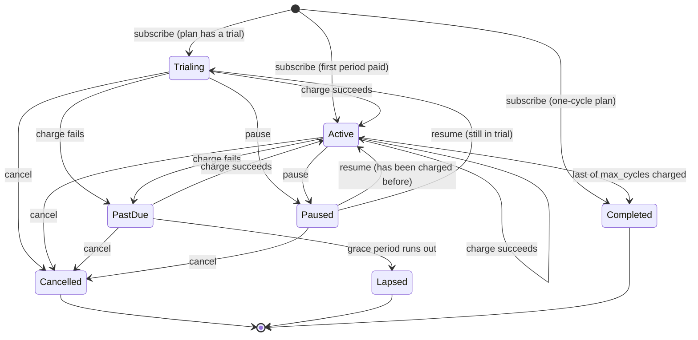

# Subscription lifecycle

A subscription is always in exactly one status. Three of them are final.

## Statuses

| Status | Code | Meaning | Can be charged |
|---|---|---|---|
| Trialing | 0 | Inside the free trial. | Yes, once the trial ends |
| Active | 1 | Paid up until `next_charge_at`. | Yes, once due |
| PastDue | 2 | The last charge failed. Keepers retry during the grace period. | Yes, any time |
| Paused | 3 | Paused by the subscriber. | No |
| Cancelled | 4 | Cancelled by the subscriber or the merchant. Final. | No |
| Lapsed | 5 | The grace period ran out. Final. | No |
| Completed | 6 | All `max_cycles` were charged. Final. | No |

## Timing rules

- **Normal charges** move `next_charge_at` forward by exactly one period, so a keeper
  that turns up a few minutes late does not drift the billing date.
- **Very late charges.** If a charge happens a full period or more after it was due,
  the schedule restarts from the time of the charge. The subscriber is never charged
  twice in quick succession to catch up.
- **Recovering from past due** also restarts the schedule from the time of the
  successful charge.
- **Pausing** stops the clock. On resume, the time spent paused is added to
  `next_charge_at`, so the subscriber keeps the days they already paid for.
- **Changing plan** while active turns the unused part of the current period into
  credit and makes the new plan due immediately. The next charge is the new price
  minus the credit. If the credit is larger than the new price, the rest carries over.

## Failed charges

A charge fails when the subscriber's allowance or balance is below the amount due. The
contract does not abort in that case. It records the failure, publishes `chg_fail` with
the reason, and returns zero, so the status change is kept.

The first failure moves the subscription to `PastDue` and starts the plan's grace
period. Keepers keep retrying. If a retry succeeds before the grace period ends, the
subscription is `Active` again. If the grace period runs out first, the next attempt
marks it `Lapsed`. With a grace period of zero, the first failure lapses it straight
away.
